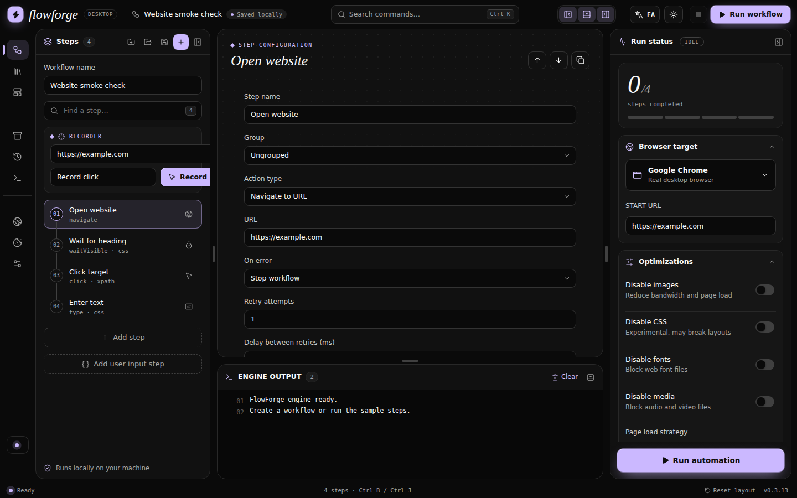
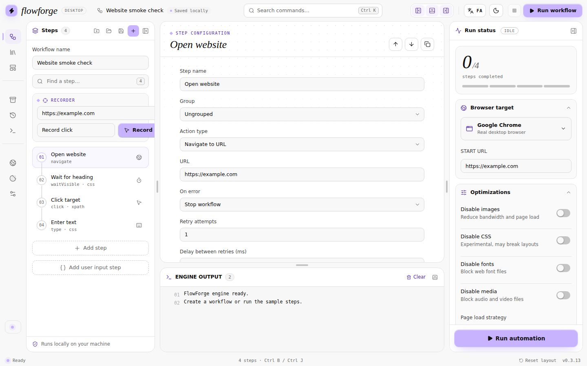
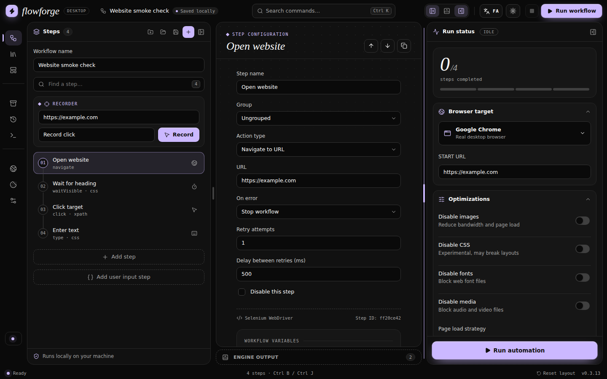
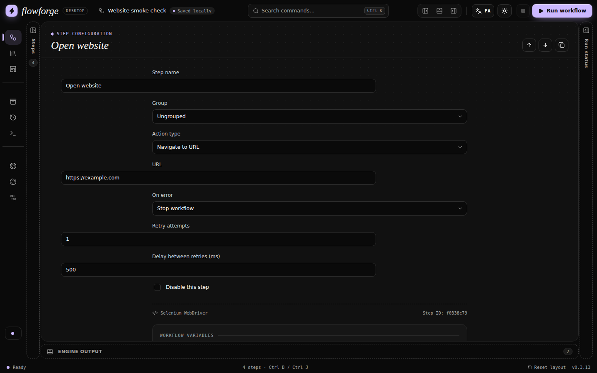
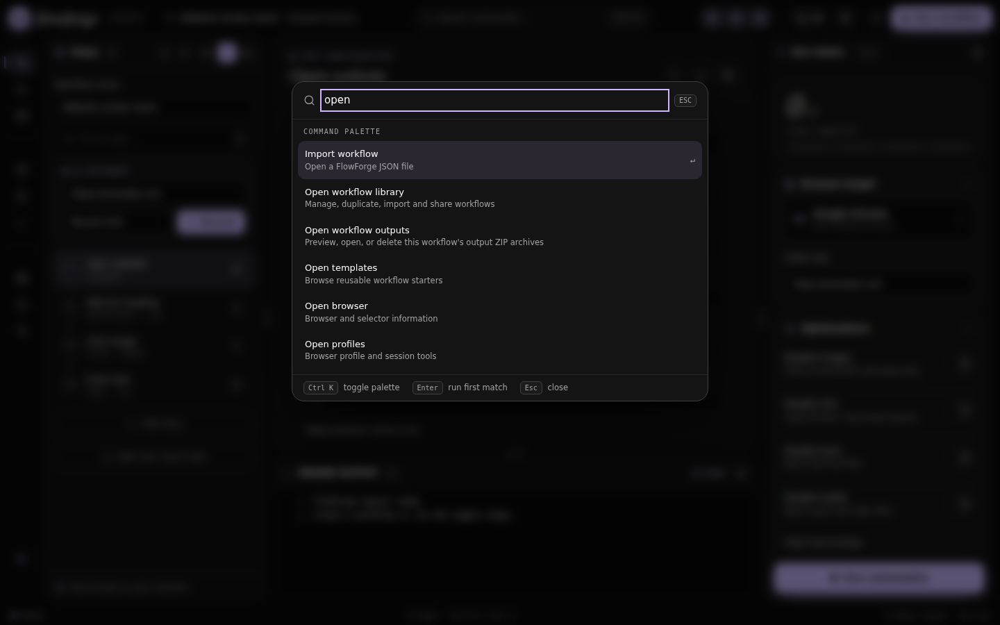
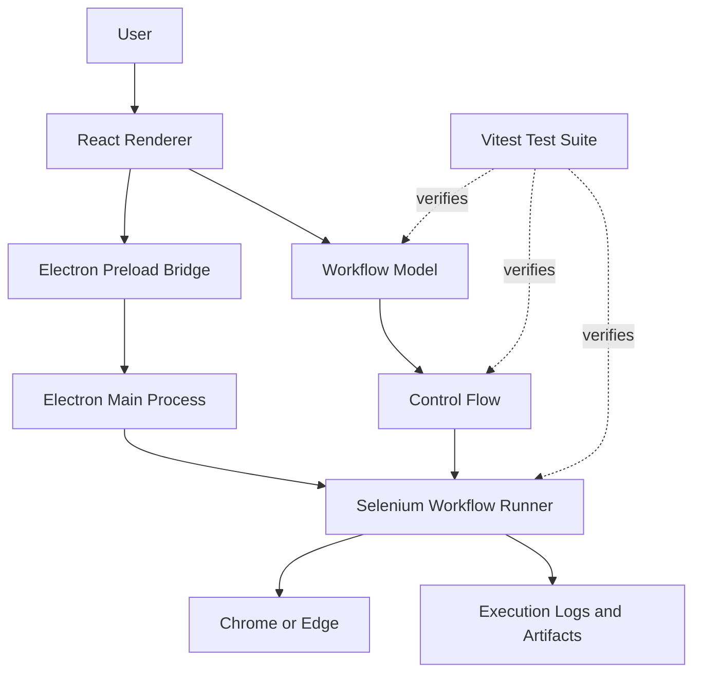

# FlowForge

**A Windows desktop application for building, configuring, and running browser automation workflows without writing automation scripts by hand.**

FlowForge provides a visual workflow editor backed by Selenium WebDriver, with configurable browser actions, control flow, variables, session management, execution logs, and workflow output artifacts.

<!-- Replace OWNER/REPOSITORY with the actual GitHub repository path. -->

[](https://github.com/OWNER/REPOSITORY/actions/workflows/ci.yml)
[](https://github.com/OWNER/REPOSITORY/releases)
[](https://github.com/OWNER/REPOSITORY/stargazers)
[](https://nodejs.org/)
[](https://www.electronjs.org/)
[](https://react.dev/)
[](https://www.typescriptlang.org/)
[](https://www.selenium.dev/)

> **Project status:** Active development. Review the latest GitHub Actions results and release notes before using a build in production.

---

## Table of Contents

- [About](#about)
- [Features](#features)
- [Screenshots](#screenshots)
- [Architecture](#architecture)
- [Tech Stack](#tech-stack)
- [Requirements](#requirements)
- [Getting Started](#getting-started)
- [Configuration](#configuration)
- [Usage](#usage)
- [Workflow Model](#workflow-model)
- [Testing and Quality Checks](#testing-and-quality-checks)
- [Building for Windows](#building-for-windows)
- [Project Structure](#project-structure)
- [Security](#security)
- [Roadmap](#roadmap)
- [Contributing](#contributing)
- [License](#license)
- [Acknowledgements](#acknowledgements)

---

## About

Browser automation is useful for repetitive browser-based tasks, smoke testing, data-entry procedures, and other routine interactions. However, writing and maintaining browser automation scripts can require programming knowledge and make simple workflows difficult to inspect or modify.

FlowForge addresses this problem with a desktop workflow editor. Users configure actions visually, arrange them in sequence, set action-specific parameters, and execute the resulting workflow through a local automation engine.

### Design goals

- **Visual workflow authoring:** Configure browser actions through an editor rather than writing a script for every task.
- **Explicit execution behavior:** Configure retries, delays, error handling, and control flow.
- **Local execution:** Run automation on the user's machine.
- **Inspectable results:** Review engine output and workflow execution status.
- **Maintainable architecture:** Keep the desktop shell, UI, workflow model, automation engine, and tests in separate areas of the repository.

FlowForge is a desktop application, not a hosted automation service. Its browser execution and local file operations run within the capabilities and permissions of the installed application.

## Features

### Workflow editor

- Create and edit multi-step workflows.
- Configure individual action types and their parameters.
- Organize steps into groups.
- Move, duplicate, enable, and disable steps where supported by the editor.
- Configure retry attempts, retry delays, and error behavior.
- Search for steps and access common commands.

### Browser automation

- Navigate to URLs.
- Interact with browser elements.
- Enter text into fields.
- Wait for elements and page conditions.
- Configure browser targets and page-load behavior.
- Use supported selectors and action-specific options.
- Record supported browser interactions through the recording functionality.

The exact actions available depend on the workflow action catalog and automation engine implementation.

### Workflow logic and data

- Configure conditional execution and control flow.
- Work with workflow variables.
- Collect and transform values using supported actions.
- Configure user-input steps.
- Use regular-expression-based text transformations where supported.
- Inspect execution results through the engine output panel.

### Browser and session options

- Configure browser optimization settings.
- Enable headless execution where supported by the installed build and browser configuration.
- Save and reuse session data through the supported session functionality.
- Configure recurring workflow jobs and application startup behavior where supported by the installed build.

### Desktop experience

- Windows desktop application built with Electron.
- Light and dark themes.
- English and Persian interface support, including right-to-left layout.
- Resizable and collapsible workspace panels.
- Keyboard shortcuts and command palette.
- Local workflow editing and execution.

### Outputs

- Review execution logs.
- Inspect generated workflow output artifacts.
- Export and import workflows through the supported workflow formats.
- Diagnose failed actions using the available execution information.

> Feature availability can vary by version. Consult the source code, release notes, and tests when relying on a specific action or scheduling behavior.

## Screenshots

### Dark editor



### Light editor



### Resizable and collapsible workspace



### Focus mode



### Command palette



A Persian RTL screenshot can be added as `assets/06-persian-rtl.png` when available.

---

## Architecture

FlowForge separates its desktop application shell, renderer UI, workflow model, and browser automation engine.



### Component responsibilities

| Component | Responsibility |
|---|---|
| React renderer | Workflow editing, configuration forms, navigation, and execution feedback |
| Workflow model | Workflow definitions, steps, and associated configuration |
| Control-flow module | Conditional and sequential workflow behavior |
| Electron preload | Exposes the approved interface between renderer and desktop process |
| Electron main process | Desktop lifecycle, privileged operations, and application integration |
| Selenium runner | Executes browser automation actions |
| Output subsystem | Collects supported logs and generated artifacts |
| Vitest | Exercises workflow, runner, control-flow, session, and related functionality |

### Execution lifecycle

1. The user creates or opens a workflow.
2. The renderer updates the workflow definition.
3. The user starts execution.
4. The desktop application passes the request through its supported integration layer.
5. The automation engine processes workflow steps and interacts with the configured browser.
6. Execution results and supported output artifacts are made available to the application.

The application is designed for local execution. The exact persistence and communication behavior should be verified against the implementation of the relevant Electron IPC handlers.

---

## Tech Stack

| Technology | Purpose |
|---|---|
| Electron 33 | Desktop application runtime |
| React 18 | Renderer UI |
| TypeScript 5.7+ | Typed UI and workflow modules |
| Selenium WebDriver 4 | Browser automation |
| Node.js 20+ | Development runtime and desktop-side JavaScript |
| Vite 6 | Renderer development server and production bundling |
| Vitest 2 | Unit and component-related tests |
| Testing Library | UI testing utilities |
| jsdom | DOM environment for tests |
| electron-builder | Windows installer packaging |
| NSIS | Windows installer target |

The project uses npm for dependency management and defines development, testing, type-checking, and packaging commands in `package.json`.

**Database:** No external database is required by the documented setup. Workflow persistence and session storage should be understood from the corresponding implementation before depending on a particular storage format.

**External API keys:** No API key is required for the standard local desktop workflow described here.

---

## Requirements

### Development environment

- Windows is the primary target for desktop packaging.
- Node.js 20 or later.
- npm, included with Node.js.
- Git.
- A supported Windows environment for building and running the Windows installer.

### Browser automation

- A supported browser, such as Google Chrome or Microsoft Edge.
- A compatible WebDriver/browser setup for the selected target and Selenium configuration.
- Network access to the sites the workflow needs to visit.

Browser driver acquisition and compatibility depend on the Selenium configuration and installed browser version.

### Verify the environment

```bash
node --version
npm --version
git --version
```

Confirm that Node.js reports version 20 or later.

---

## Getting Started

### 1. Clone the repository

Replace the repository URL with the actual GitHub URL.

```bash
git clone https://github.com/OWNER/REPOSITORY.git
cd REPOSITORY
```

### 2. Install dependencies

```bash
npm install
```

### 3. Verify the release configuration

```bash
npm run verify:release
```

This runs the repository's release-configuration verification script.

### 4. Run the application in development

```bash
npm run dev
```

The development script starts the Vite development server on `127.0.0.1:5173`, waits for it to become available, and then launches Electron.

### 5. Run the test suite

```bash
npm test
```

### 6. Build the renderer

```bash
npm run build
```

The production renderer bundle is generated by Vite.

### 7. Build the Windows installer

```bash
npm run build:win
```

The Windows NSIS installer is generated in the configured `release/` output directory.

---

## Configuration

### Environment variables

The standard scripts shown in `package.json` do not require an `.env` file or a third-party API key.

Do not add undocumented environment variables and assume the application will consume them. Configuration should follow the actual implementation and the relevant Electron or runner interfaces.

For local development, the following values describe the Vite development endpoint already used by the development script:

| Setting | Value | Purpose |
|---|---|---|
| Development host | `127.0.0.1` | Local Vite binding |
| Development port | `5173` | Renderer development server |
| Node.js version | `20+` | Runtime requirement |

The development host and port are configured in the npm scripts and Vite setup rather than being documented here as supported `.env` variables.

### Browser configuration

Browser target, optimization flags, headless behavior, and page-load settings are configured through the application where supported.

Available options depend on the installed FlowForge version. Check the workflow editor and the runner configuration before assuming an option is supported by every browser.

### Workflow configuration

Workflow definitions and step settings are managed by the application. Use the editor's import/export functionality when available rather than manually editing generated runtime data without validating its schema.

---

## Usage

### Create a workflow

1. Launch FlowForge.
2. Create a new workflow or open an existing one.
3. Give the workflow a descriptive name.
4. Add the required actions.
5. Select each action and configure its parameters.
6. Configure error handling, retries, delays, and any supported conditions.
7. Review the workflow from top to bottom.
8. Run the workflow and inspect the engine output.

### Example workflow

A basic website smoke check can be represented as:

```text
Workflow: Website smoke check

1. Navigate to URL
   URL: https://example.com

2. Wait for element
   Selector: h1

3. Verify expected content
   Expected text: Example Domain

4. Finish
```

This is a conceptual example of the workflow. The exact selector fields, assertion action name, and supported result-checking behavior depend on the action catalog in the checked-out version.

### Run a workflow

Use the Run Workflow or Run Automation control in the application.

During execution:

- Monitor the run-status panel.
- Review the engine output for progress and errors.
- Check the configured retry and error-handling behavior.
- Inspect generated outputs after completion.

### Headless execution

When supported by the installed build, headless mode allows browser automation to run without displaying the normal browser window.

Use headless mode only after verifying that the target workflow works correctly in a visible browser. Some websites behave differently depending on browser configuration, permissions, authentication, or rendering behavior.

### Regular-expression variable transformation

A supported regex transformation can be used to derive an output variable from an input string.

For example, in JavaScript:

```js
const source = "123-4567";
const pattern = /(\d{3})-(\d{4})/g;
const result = source.replace(pattern, "$1/$2");

console.log(result);
// 123/4567
```

In a FlowForge workflow, configure the equivalent source variable, pattern, replacement, flags, and destination variable through the action editor.

### Automatic jobs

Where scheduling is available, configure the workflow's interval or supported startup trigger in the application.

Distinguish between scheduling while the application is running and launching the application at Windows sign-in. These behaviors have different lifecycle requirements. Verify startup registration and unattended execution on the target Windows machine before relying on them for critical tasks.

---

## Workflow Model

A workflow consists of a sequence of steps and the configuration required to execute them.

Conceptually:

```text
Workflow
├── Metadata
│   ├── Name
│   └── Workflow settings
├── Steps
│   ├── Action configuration
│   ├── Retry policy
│   ├── Error handling
│   └── Enabled state
├── Variables
├── Control flow
└── Execution outputs
```

### Recommended workflow practices

- Give workflows and steps descriptive names.
- Prefer explicit waits over arbitrary long delays where possible.
- Use retries for transient failures rather than masking invalid selectors.
- Keep credentials out of workflow exports and source control.
- Test workflows against a non-production environment first.
- Validate conditions and variable references before running long workflows.
- Make workflows safe to retry when the underlying operation can create or modify data.

---

## Testing and Quality Checks

FlowForge uses Vitest for its test suite and TypeScript for static type checking.

### Run all tests

```bash
npm test
```

### Run tests in watch mode

```bash
npm run test:watch
```

### Test the automation runner

```bash
npm run test:engine
```

### Test control flow

```bash
npm run test:control-flow
```

### Run TypeScript checks

```bash
npm run typecheck
```

### Verify release configuration

```bash
npm run verify:release
```

### Build the renderer

```bash
npm run build
```

### Recommended pre-release sequence

Run the following from the repository root:

```bash
npm install
npm run verify:release
npm run typecheck
npm test
npm run build:win
```

A successful installer build should be followed by manual smoke testing on a Windows machine.

### Current quality boundaries

Unit tests cannot replace end-to-end verification of the desktop app and browser. Before releasing, verify:

- Application startup and shutdown.
- Workflow creation, editing, saving, and reopening.
- Browser startup and navigation.
- Representative actions and control-flow paths.
- Error handling and retry behavior.
- Session persistence, if used.
- Headless and visible browser modes.
- Scheduled and startup-triggered execution, if used.
- Output artifact generation.
- Light and dark themes, panel resizing, and Persian RTL.
- Installer installation, launch, and uninstall.

No formatter or linter script is currently defined in the provided `package.json`. Add one before documenting a formatter command as part of the required CI workflow.

---

## Building for Windows

FlowForge uses `electron-builder` to create a Windows NSIS installer.

Run:

```bash
npm run build:win
```

The package configuration specifies:

- Product name: `FlowForge`
- Application ID: `com.flowforge.desktop`
- Target: Windows NSIS installer
- Architecture: x64
- Output directory: `release/`
- Configurable installation directory
- Desktop and Start Menu shortcuts

The generated installer filename includes the application version and architecture.

### Continuous integration

The repository contains GitHub Actions workflows for:

- Running verification on pushes, pull requests, and manual dispatches.
- Building the Windows installer.
- Uploading installer artifacts.
- Publishing tagged releases.
- Generating SHA-256 checksums for release artifacts.

Consult the workflow files under `.github/workflows/` for the authoritative release behavior.

---

## Project Structure

The following tree highlights the main application modules. Refer to the repository for the complete file list.

```text
flowforge/
├── .github/
│   ├── ISSUE_TEMPLATE/
│   └── workflows/
│       ├── ci.yml
│       ├── release.yml
│       └── auto-release.yml
├── assets/
│   ├── 01-dark-editor.png
│   ├── 02-light-editor.png
│   ├── 03-resize-and-hide.png
│   ├── 04-focus-mode.png
│   └── 05-palette.png
├── docs/
│   ├── ADVANCED-ACTIONS-AND-OUTPUTS.md
│   ├── ROADMAP.md
│   ├── RELEASING.md
│   └── UI-DESIGN.md
├── electron/
│   ├── main.cjs
│   ├── preload.cjs
│   └── global.d.ts
├── engine/
│   ├── runner.cjs
│   ├── recorder-bridge.js
│   └── zip.cjs
├── scripts/
│   └── verify-release.cjs
├── src/
│   ├── core/
│   │   ├── workflow.ts
│   │   ├── controlFlow.ts
│   │   ├── recorder.ts
│   │   ├── session.ts
│   │   └── workflowLibrary.ts
│   ├── ui/
│   │   ├── App.tsx
│   │   ├── AnimatedIcons.tsx
│   │   └── styles.css
│   ├── main.tsx
│   └── global.d.ts
├── tests/
│   ├── runner.test.ts
│   ├── advancedActions.test.ts
│   ├── workflow.test.ts
│   ├── workflowLibrary.test.ts
│   ├── controlFlow.test.ts
│   ├── recorder.test.ts
│   └── session.test.ts
├── package.json
├── tsconfig.json
├── vite.config.ts
└── README.md
```

### Key modules

- `src/core/workflow.ts`: Workflow definitions and related core operations.
- `src/core/controlFlow.ts`: Workflow control-flow behavior.
- `src/core/recorder.ts`: Recording-related core logic.
- `src/core/session.ts`: Session-related functionality.
- `src/core/workflowLibrary.ts`: Workflow library functionality.
- `src/ui/App.tsx`: Main renderer application.
- `src/ui/styles.css`: UI styling and theme rules.
- `src/ui/AnimatedIcons.tsx`: Animated icon components.
- `electron/main.cjs`: Electron main process.
- `electron/preload.cjs`: Renderer integration bridge.
- `engine/runner.cjs`: Browser automation execution engine.
- `engine/zip.cjs`: ZIP/output artifact handling.
- `tests/`: Automated test suite.
- `docs/RELEASING.md`: Release procedures.
- `docs/ROADMAP.md`: Project roadmap.

---

## Security

Browser automation can access sensitive information and perform actions on websites using the permissions available to the browser and operating system.

Use the following precautions:

- Only automate websites and accounts you are authorized to access.
- Do not commit credentials, cookies, access tokens, or session exports.
- Treat workflow imports and browser-generated content as untrusted input.
- Review workflows before running them against production systems.
- Avoid exposing privileged Electron APIs directly to arbitrary renderer content.
- Keep Electron security settings restrictive and review changes to IPC handlers.
- Do not disable browser security protections merely to make a workflow work.
- Store session artifacts securely and delete them when no longer needed.
- Review the permissions required by scheduled or startup-triggered automation.
- Keep dependencies updated and review security advisories.

For security-sensitive reports, use the repository's private reporting process if one is configured. Otherwise, open a minimal public issue without including secrets or exploit details until a secure channel is available.

---

## Roadmap

The checked items below represent features and infrastructure present in the repository. They do not imply that every platform or end-to-end scenario has been fully validated.

### Implemented in the codebase

- [x] Electron desktop application shell.
- [x] React and TypeScript workflow editor.
- [x] Selenium WebDriver automation runner.
- [x] Workflow definition and control-flow modules.
- [x] Browser recording-related functionality.
- [x] Workflow library support.
- [x] Session-related functionality.
- [x] Engine output and artifact handling.
- [x] Vitest test suite.
- [x] TypeScript check command.
- [x] Windows NSIS packaging configuration.
- [x] GitHub Actions CI and release workflows.
- [x] Light and dark themes.
- [x] Resizable and collapsible workspace panels.
- [x] English and Persian interface support in the UI code.

### Planned or requiring further qualification

- [ ] Expand end-to-end tests for representative workflows.
- [ ] Verify headless execution across supported browser configurations.
- [ ] Verify Windows startup registration and scheduled execution across restarts.
- [ ] Add accessibility checks to automated UI tests.
- [ ] Add visual regression tests for themes, focus mode, and RTL layout.
- [ ] Define and enforce a formatter and linting policy.
- [ ] Document the workflow schema and supported action catalog.
- [ ] Establish a verified license and contribution policy.
- [ ] Publish tested release artifacts with checksums and release notes.

The maintained roadmap in `docs/ROADMAP.md` should be treated as the more detailed source of truth for project priorities.

---

## Contributing

Contributions are welcome. Please keep changes focused, testable, and consistent with the existing architecture.

### Before opening a pull request

1. Check existing issues and discussions.
2. Open an issue for substantial changes or new features.
3. Create a focused branch.
4. Implement the change with relevant tests.
5. Run the type checker and test suite.
6. Update documentation when behavior or configuration changes.
7. Open a pull request describing the change and its validation.

### Branch naming

Use descriptive branch names such as:

```text
feature/regex-variable-transform
fix/headless-default
docs/update-installation
test/workflow-control-flow
refactor/editor-layout
```

### Suggested commit conventions

```text
feat: add workflow action
fix: normalize browser options
docs: clarify Windows setup
test: cover conditional execution
refactor: separate editor components
```

### Pull request checklist

- [ ] The change has a clear purpose.
- [ ] Existing behavior is preserved unless intentionally changed.
- [ ] New logic has appropriate tests.
- [ ] `npm run typecheck` passes.
- [ ] `npm test` passes.
- [ ] Documentation is updated where necessary.
- [ ] No credentials, generated secrets, or unnecessary build artifacts are committed.
- [ ] UI changes are checked in light mode, dark mode, and RTL where applicable.

---

## License

**The repository license has not been verified.**

Before publishing the repository publicly, add the appropriate `LICENSE` file and update this section to identify the actual license. Do not describe the project as MIT-licensed or otherwise grant permissions until the repository owner has selected and committed a license.

Third-party dependencies remain subject to their respective licenses.

## Acknowledgements

FlowForge builds on the following open-source technologies:

- [Electron](https://www.electronjs.org/) for the desktop application runtime.
- [React](https://react.dev/) for the UI.
- [TypeScript](https://www.typescriptlang.org/) for static typing.
- [Selenium](https://www.selenium.dev/) for browser automation.
- [Vite](https://vite.dev/) for development and bundling.
- [Vitest](https://vitest.dev/) for automated testing.
- [electron-builder](https://www.electron.build/) for desktop packaging.

Thanks to the maintainers and contributors of these projects.

---

## Support

For bugs and feature requests, use the repository's [GitHub Issues](https://github.com/OWNER/REPOSITORY/issues) page after replacing `OWNER/REPOSITORY` with the actual repository path.

For reproducible bug reports, include:

- FlowForge version.
- Windows version.
- Node.js version when relevant.
- Browser and browser version.
- Minimal workflow or reproduction steps.
- Relevant engine output with credentials and personal information removed.

**FlowForge is intended to make browser automation easier to author and inspect. Always validate workflows in a safe environment before using them for important or irreversible operations.**
