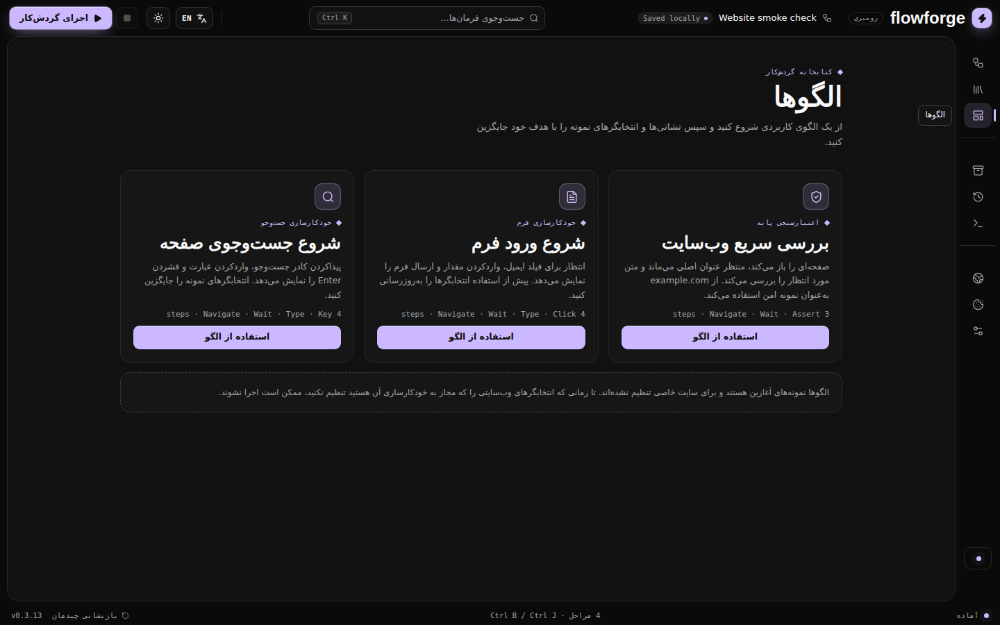

# FlowForge Desktop

FlowForge is a Windows-first desktop application for building, running, and organizing browser automation workflows. It combines **Electron**, **React**, **TypeScript**, and **Selenium WebDriver** in a local-first interface. Automations run in a real Chrome or Microsoft Edge browser, not in an embedded webpage.

> **Project status:** active development. Run the checks and exercise the packaged app on Windows before using it for important or unattended tasks.

## Screenshots

The screenshots below are expected in `assets/`. Add the captured PNG files using these exact names to make the gallery render on GitHub.

| Dark editor | Light editor |
|---|---|
|  |  |

| Resize and hide panels | Focus mode |
|---|---|
|  |  |

| Command palette | Persian RTL |
|---|---|
|  |  |

## Features

- **Visual workflow editor:** create, rename, duplicate, reorder, disable, group, and configure sequential steps.
- **Browser actions:** navigate, click, type, keyboard input, hover, drag and drop, scroll, select options, upload files, switch tabs and frames, and handle browser alerts.
- **Waits and assertions:** wait for visibility or clickability; check text, URLs, titles, element presence/count, and attributes.
- **Control flow:** if/else branches, repeat-N, list loops, bounded while loops, break/continue, retries, and reusable nested workflows.
- **Variables and user input:** set variables, transform text with regular expressions, extract values, and ask for typed runtime input.
- **Data capture and outputs:** extract text, attributes, values, tables, or collections; take screenshots; save text and images; collect downloads; and package run artifacts into ZIP archives.
- **Browser profiles and sessions:** use a persistent user-data directory and export/import a site-origin session snapshot.
- **Headless mode and loading options:** configure headless Chrome/Edge, resource blocking, page-load strategy, and browser cleanup.
- **Automatic jobs:** run a workflow on a repeating timer while FlowForge is open, or request launch-at-login behavior on Windows.
- **Workflow library:** create, reopen, duplicate, import, export, and run reusable workflows.
- **Run history and diagnostics:** review recent outcomes, step statuses, and engine logs.
- **Theme and localization:** dark/light themes, English/Persian language switching, Persian RTL layout, and Vazirmatn font fallbacks.
- **Keyboard-friendly UI:** command palette (`Ctrl+K`), resizable/collapsible panels, and reduced-motion-aware icon animation.

See [`docs/ADVANCED-ACTIONS-AND-OUTPUTS.md`](docs/ADVANCED-ACTIONS-AND-OUTPUTS.md) for action details, output formats, limits, and integration notes. See [`docs/ROADMAP.md`](docs/ROADMAP.md) for planned work.

## Requirements

- Windows 10 or Windows 11 for the intended desktop experience and installer.
- Node.js 20 or newer and npm.
- Google Chrome and/or Microsoft Edge.
- Network access for Selenium Manager to resolve a compatible driver, or a compatible driver installed locally.

FlowForge checks known local driver paths on Windows and otherwise falls back to Selenium Manager. See [manual driver detection](docs/RELEASING.md) and the engine notes before overriding driver locations.

## Quick start

```powershell
git clone <your-repository-url>
cd flowforge
npm install
npm run dev
```

The development command starts Vite and Electron. If you only want to build the renderer UI:

```powershell
npm run build
```

To launch the built application:

```powershell
npm start
```

To build the Windows NSIS installer:

```powershell
npm run build:win
```

Installer output is written to `release/`. See [`docs/RELEASING.md`](docs/RELEASING.md) for release requirements and artifact verification.

## Development checks

Run these before submitting a change or creating a release:

```powershell
npm run verify:release
npm run typecheck
npm test
npm run build
```

For a Windows release candidate, also run `npm run build:win` and install/launch the resulting installer on a clean Windows environment. Unit tests do not replace live-browser smoke tests.

## Repository layout

```text
flowforge/
├── assets/                   # README screenshots and project artwork
├── docs/                     # Roadmap, advanced actions, and release guidance
├── electron/                 # Main process, preload bridge, IPC boundary
├── engine/                   # Selenium runner, recorder bridge, ZIP output support
├── scripts/                  # Release configuration verification
├── src/
│   ├── core/                 # Workflow model, validation, sessions, recorder, library
│   ├── ui/
│   │   ├── data/             # Action catalog and shared UI data
│   │   ├── i18n/             # English/Persian translation utilities
│   │   ├── layout/           # App shell and workspace layout primitives
│   │   ├── widgets/          # Reusable editor widgets (action picker, etc.)
│   │   ├── App.tsx           # App composition and state orchestration
│   │   ├── AnimatedIcons.tsx # Local animated SVG icon components
│   │   └── styles.css        # Design tokens, themes, layout, responsive rules
│   └── main.tsx              # React entry point
├── tests/                    # Unit and workflow-engine tests
├── .github/workflows/        # CI and Windows release workflows
├── package.json
└── README.md
```

The UI is split into layout, widget, data, and localization modules so reusable pieces can be changed independently. Keep new visual components in `src/ui/widgets/`, app-wide layout primitives in `src/ui/layout/`, static UI catalogs in `src/ui/data/`, and language copy in `src/ui/i18n/`. Avoid adding new large sections directly to `App.tsx` when they can be composed as widgets.

## Workflow basics

1. Open **Editor** and give the workflow a clear name.
2. Add actions in order and configure their target locators, values, timeouts, and error policies.
3. Use groups, variables, conditions, and loops to make larger workflows readable.
4. Validate the workflow and press **Run workflow**.
5. Review step state and logs, then inspect the generated artifacts in **Outputs**.
6. Export a workflow package before sharing it with another machine.

Supported locators include CSS, XPath, ID, name, class name, link text, and tag name where applicable. Prefer stable selectors and explicit waits over long fixed sleeps.

## Scheduling and startup behavior

The repeating timer runs in the renderer while FlowForge remains open. It is not a Windows background service and it does not guarantee execution after the app exits or the machine sleeps. Launch-at-login is a separate Windows setting; validate it on the target machine. A workflow is skipped by the scheduler if another workflow run is already active.

## Security and privacy

- Workflow execution is local to the desktop app, but workflows can navigate to websites and submit data. Review every action before running it.
- Persistent browser profiles and session snapshots can contain authentication cookies or other secrets. Session snapshots are plain JSON, not encrypted. Store them securely and never commit them to source control.
- Inspect workflow exports and output archives before sharing. They may contain personal information, page content, screenshots, or downloaded files.
- Do not point a persistent profile at a browser profile that is currently open.
- The renderer communicates with Electron through a restricted preload bridge. Do not expose arbitrary Node.js APIs to the renderer.
- See [`SECURITY.md`](SECURITY.md) for reporting security concerns.

## Localization and UI conventions

English is the default language. Persian mode sets the document language and direction to RTL and uses Vazirmatn with local fallbacks. Keep layouts direction-aware; avoid hard-coded left/right assumptions when adding controls. Dark and light theme preferences are stored locally. Animation should respect the operating system's reduced-motion preference.

## CI and releases

GitHub Actions workflows are located in `.github/workflows/`:

- `ci.yml` runs release configuration checks, TypeScript, tests, and a Windows installer build for pushes and pull requests.
- `release.yml` builds and publishes an installer for version tags such as `v0.3.14`.
- `auto-release.yml` can create a patch release from the configured default branch after checks pass.

Repository Actions permissions must allow release creation for release workflows. Check workflow logs and the SHA-256 checksum file before distributing artifacts. Refer to [`docs/RELEASING.md`](docs/RELEASING.md).

## Contributing

1. Create a focused branch.
2. Make a small, reviewable change and add tests for behavior changes.
3. Run `npm run verify:release`, `npm run typecheck`, and `npm test`.
4. For UI changes, check dark and light themes, narrow and wide window sizes, panel resizing/collapse, and Persian RTL.
5. For engine changes, test the affected action in Chrome and Edge when available.
6. Update the README or relevant docs when user-facing behavior changes.

Keep pull requests focused and include before/after screenshots for significant interface changes.

## License

No license has been declared in this repository yet. Add a `LICENSE` file before presenting the project as open source or accepting contributions under a specific license.
